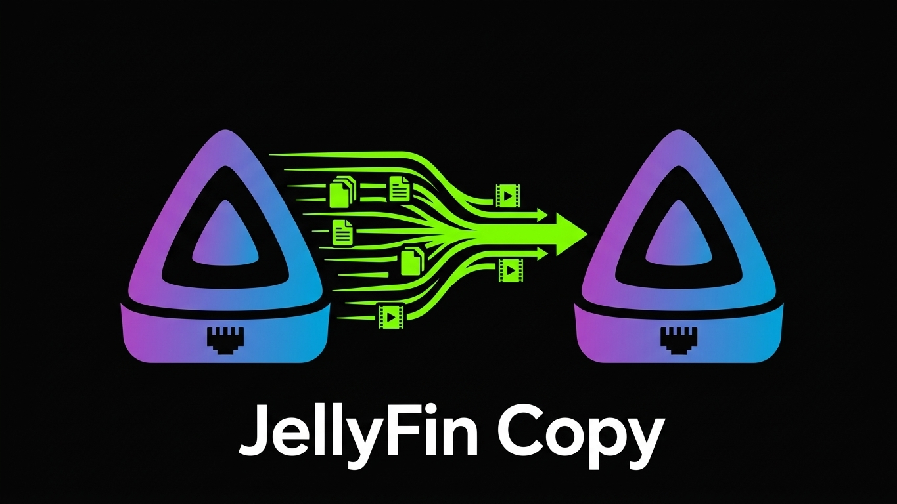

<p align="center">
  
</p>

# Jelly2JellyCopy

**Migrate or copy media from one Jellyfin server to another, from a web page.**

- **Migrating:** moving from your old server to a new one? Log into the old
  server and pull everything (or only what you want) across into the new
  one's library folders. You don't need shell access to the old box or any
  disks shuffled between machines.
- **Copying:** a friend has a show you want? Log in with the account they
  gave you, pick the series, seasons or movies, and queue them.

Jelly2JellyCopy runs as one small container next to your Jellyfin. It
downloads the **original files** (no transcoding) through the source server's
normal API. It writes them straight into the folders your Jellyfin libraries
already watch, named the way Jellyfin, Sonarr and Radarr expect, and then
triggers a library scan.

> **Status:** in development. The skeleton (login, theme, container, CI) is
> done; connecting, browsing and the download queue are being built.

## Features

- Browse the source server's libraries, with search, an A–Z filter and posters.
- Queue a whole series, season 1 only, or pick seasons by hand. Movies and
  music albums are one click.
- Pick the destination folder each time you open a library. The options come
  from your own Jellyfin's library folders, e.g. `Movies — /movies` or
  `Kids Movies — /kids-movies`.
- "✔ On my server" badges on items you already have.
- A download queue that resumes after a dropped connection, retries, survives
  restarts and shows live progress.
- Half-written files never appear in your library. Downloads go to
  `<name>.j2jpart` and are renamed only once complete and the size checks out.
- Black and neon-green theme, with no CDNs and no external calls besides the
  two Jellyfin servers.

## What you need

- Docker, on the same machine (and Docker network) as your Jellyfin.
- An account on the **source** server with **"Allow media downloading"**
  enabled (Jellyfin Dashboard → Users → the user → Allow media downloading).
- An **API key** for your own Jellyfin (Dashboard → API Keys). It is used to
  find your library folders, mark items you already have and trigger scans.

## Quick start

Copy [compose.prod.yaml](compose.prod.yaml) into a folder on your server as
`docker-compose.yml`, and put a `.env` next to it:

```env
J2J_APP_PASSWORD=pick-a-long-password
J2J_DEST_API_KEY=your-jellyfin-api-key
```

**The one rule:** mount your media folders at the **same container paths your
Jellyfin container uses**. Jellyfin reports its library folders as paths inside
its own container (`/movies`, `/tv`, …), and Jelly2JellyCopy offers those
paths as destinations, so they have to mean the same thing in both containers.

```yaml
services:
  app:
    image: ghcr.io/hermanras/jelly2jellycopy:latest
    container_name: jelly2jelly
    user: "1000:1000"                 # same PUID/PGID as your Jellyfin
    environment:
      J2J_APP_PASSWORD: ${J2J_APP_PASSWORD}
      J2J_DEST_URL: http://jellyfin:8096
      J2J_DEST_API_KEY: ${J2J_DEST_API_KEY}
    volumes:
      - ./data:/data
      - /path/to/media/movies:/movies     # same as in your Jellyfin compose
      - /path/to/media/tv:/tv
    restart: unless-stopped

networks:
  default:
    name: proxy        # the network your Jellyfin and reverse proxy are on
    external: true
```

```sh
mkdir -p data && sudo chown 1000:1000 data
docker compose up -d
```

There is no published port. Point your reverse proxy at
`http://jelly2jelly:8000` from the same Docker network. To reach it on your LAN without a proxy, add
`ports: ["8000:8000"]` instead.

## Configuration

| Variable | Default | Purpose |
|---|---|---|
| `J2J_APP_PASSWORD` | `jelly2jelly` | Password for the web page. **Change it.** A red banner shows while the default is in use. |
| `J2J_DEST_URL` | — | Your Jellyfin, e.g. `http://jellyfin:8096` over the shared Docker network |
| `J2J_DEST_API_KEY` | — | API key for your Jellyfin |
| `J2J_DEST_FOLDERS` | — | Fallback when there is no API key: `movies=/movies;tvshows=/tv;music=/music` |
| `J2J_SECRET` | generated into `/data/secret.key` | Encrypts the stored source token and signs the login cookie |
| `J2J_FREE_SPACE_RESERVE_GB` | `50` | A download won't start if it would eat into this much free space |

## Security

- Every page is behind the app password, and logins are rate-limited.
- Your password for the source server is used once to log in and is never
  stored. Only the access token Jellyfin hands back is kept, encrypted.
  **Disconnect** logs that session out on the source server and deletes the
  token.
- Files are only ever written under the destination folders, with path
  traversal checks.

Please only copy media you're allowed to.

## Development

Everything runs in Docker; nothing needs installing on the host.

```sh
docker compose up --build                                        # http://localhost:8000
docker compose -f compose.yaml -f compose.dev.yaml up --build    # live reload
docker build --target test -t jelly2jelly-test . && docker run --rm jelly2jelly-test
```

CI ([.github/workflows/image.yml](.github/workflows/image.yml)) builds the
image, runs the tests, starts the container and checks it, and only then
pushes `latest`, `sha-<commit>` and `v*` tags to GHCR.
